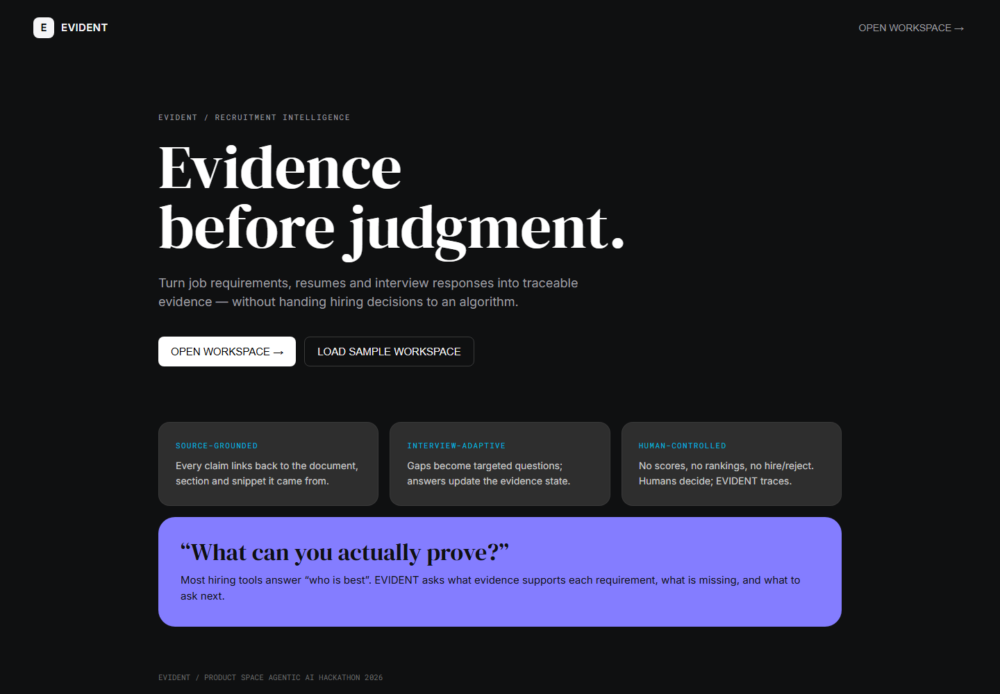

# EVIDENT

**Evidence before judgment.**

EVIDENT organizes the evidence hiring teams need to make their own decisions. It does not score candidates, rank them, or decide who gets hired.

[Live app](https://evident-olive.vercel.app) · [Architecture](docs/ARCHITECTURE.md) · [Demo script](docs/DEMO_SCRIPT.md)



## Problem

Recruiters work across job descriptions, resumes, interview notes and evaluation write-ups. Connecting each claim to each requirement is manual, inconsistent and slow. Most resume tools respond with a single score that hides the reasoning.

EVIDENT treats recruiting as an evidence problem, not a reading problem.

## Solution

EVIDENT builds a candidate evidence graph per workspace. Requirements come from the job description. Claims come from resumes. Every link carries a status, source document, snippet, interpretation and the interview question that would resolve it. Interview answers update the graph. Every action is audit-trailed.

```text
JOB REQUIREMENT → CANDIDATE CLAIM → SOURCE EVIDENCE → UNCERTAINTY
→ INTERVIEW QUESTION → RESPONSE → FOLLOW-UP → UPDATED EVIDENCE → HUMAN REVIEW
```

## What it does

- Upload a job description and multiple resumes as PDF or text. PDFs are extracted server-side with per-page sources.
- Extract structured requirements and candidate profiles.
- Map evidence into six canonical states, including `EVIDENCE FOUND`, `NEEDS VALIDATION` and `NO EVIDENCE FOUND`.
- Surface validation gaps and generate candidate-specific interview questions.
- Record interview answers through a real AI analysis path, then update evidence status and generate follow-ups.
- Query the candidate pool in natural language with source references.
- Generate standardized evidence reports.
- Keep a full audit trail of workspace activity.

## Proof

These are implementation facts, not accuracy claims:

- **3-provider failover.** Gemini 2.5 Flash is primary; Groq and Mistral are automatic fallbacks for 429s, 5xx responses, network failures and invalid output (`lib/gemini.ts`).
- **Schema-validated model output.** Every model-facing orchestrator tool validates its response with Zod before persistence (`lib/orchestrator.ts`, `lib/schemas.ts`).
- **Source-linked evidence.** Document, section and snippet are stored for each claim. Unknowns are labelled rather than invented.
- **Real demo pipeline.** The sample workspace is generated by the same pipeline as a user workspace (`pages/api/sample.ts`).
- **Regression scripts.** `scripts/ask-regression.mjs` and `scripts/consistency.mjs` check query behavior and cross-view state consistency.

## How it works

One orchestrator in `lib/orchestrator.ts` exposes typed tools for:

1. Requirement extraction
2. Candidate profile extraction
3. Evidence mapping
4. Validation-gap detection
5. Interview planning
6. Response analysis
7. Follow-up generation
8. Candidate-pool query
9. Report generation
10. Evidence-map update

Deterministic software handles storage, persistence, audit events, validation and the UI. AI is used for extraction and interpretation, not for the final hiring decision.

The core workflow is: create a workspace → upload documents → analyze evidence → inspect the evidence matrix → open a candidate dossier → record an interview answer → ask follow-up questions → review the audit trail.

## Technology

- Next.js 14, React, TypeScript
- Supabase (PostgreSQL + Storage)
- Gemini 2.5 Flash, Groq and Mistral failover
- Zod structured outputs
- `unpdf` server-side PDF extraction
- Vercel

## Demo

Live: **https://evident-olive.vercel.app**

Open the app and choose **Load Sample Workspace** to run synthetic documents through the real pipeline. A three-minute walkthrough is in [`docs/DEMO_SCRIPT.md`](docs/DEMO_SCRIPT.md).

## Run locally

```bash
npm install
cp .env.example .env.local   # fill values
npm run dev
```

Apply `supabase/schema.sql` and `supabase/migrate-evidence.sql`, then create the `job_descriptions` and `candidate_resumes` storage buckets.

Required environment variables:

| Variable | Purpose |
|---|---|
| `NEXT_PUBLIC_SUPABASE_URL` / `NEXT_PUBLIC_SUPABASE_ANON_KEY` | Database and storage |
| `GEMINI_API_KEY` | Primary AI provider (server-only) |
| `GROQ_API_KEY` / `MISTRAL_API_KEY` | Failover providers (server-only) |
| `GROQ_MODEL` / `MISTRAL_MODEL` / `AI_PROVIDER_ORDER` | Optional overrides |

`npm run build` must pass before deploying.

## Limitations

- The full pipeline needs Supabase and at least one model provider. Without an AI key, analysis falls back to deterministic keyword matching, which is materially weaker.
- There is no authentication or team management yet. Workspaces are link-accessed.
- PDF report export, real-time interview mode, voice transcription and ATS integrations are roadmap items, not current features.
- Model output can still be wrong. Source links and human review are the control, not a guarantee.

## Security and disclosure

API keys stay server-side; `/api/settings` returns booleans only. Uploads are type- and size-checked. Documents are treated as untrusted data to reduce prompt-injection risk. See [`docs/SECURITY.md`](docs/SECURITY.md).

Built with AI coding assistance under human direction. The product concept, architecture decisions, testing, deployment and submission were directed by the team. See [`docs/AI_DISCLOSURE.md`](docs/AI_DISCLOSURE.md).

## Author

Swapneel Sethi · [GitHub](https://github.com/Swapneel-Sethi)
