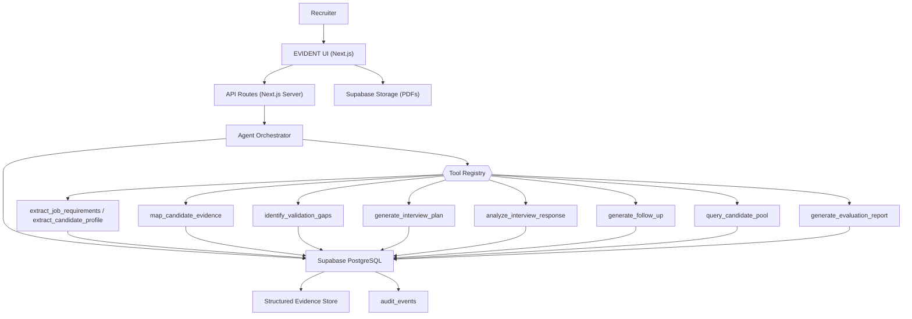

# Architecture Overview

* **Frontend**: Next.js, TypeScript, React, Tailwind, shadcn/ui.
* **Backend**: Next.js API routes serve as thin serverless functions.
* **Database**: Supabase PostgreSQL stores workspaces, jobs, candidates, evidence graph, audit events.
* **Storage**: Supabase Storage holds uploaded PDFs and extracted text.
* **AI**: Gemini (primary) accessed via server‑side SDK; all calls enforce structured JSON schemas.
* **Agent Orchestrator**: single orchestrator agent coordinates tool calls, updates DB, logs audit events, and streams activity to UI.

The orchestrator follows the agentic loop:
`Goal -> Determine Operations -> Select Tools -> Execute -> Observe -> Identify Gaps -> Next Action`.
