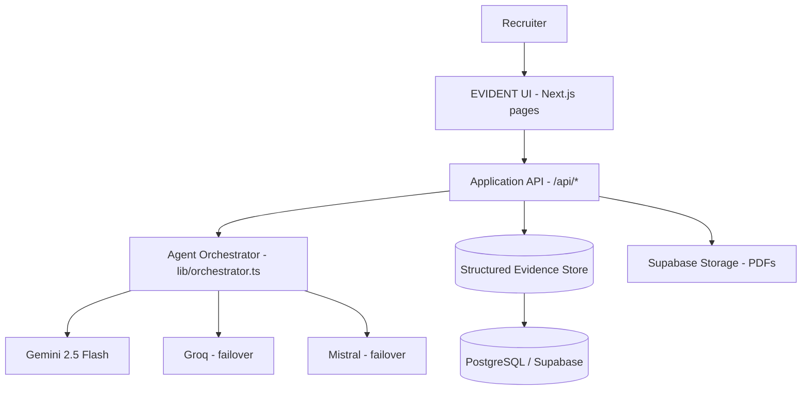
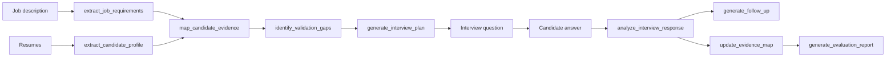
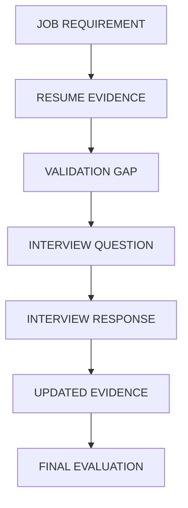

# Architecture

## System

## Tool flow

## Evidence lifecycle

## Canonical state

One writer (`lib/pipeline.ts` → `persistAnalysis`), one reader (`/api/state`):
`job_requirements`, `evidence_states`, `interview_responses`, `audit_events`.
Overview, Matrix, Dossier, Interview, Report, Ask and Audit all derive from `/api/state`.

## AI vs deterministic split

AI: requirement interpretation, resume understanding, semantic linking, ambiguity
detection, interview planning, answer interpretation, follow-ups, NL queries.
Deterministic: storage, persistence, audit, validation, permissions, UI state,
source navigation, failover routing.
